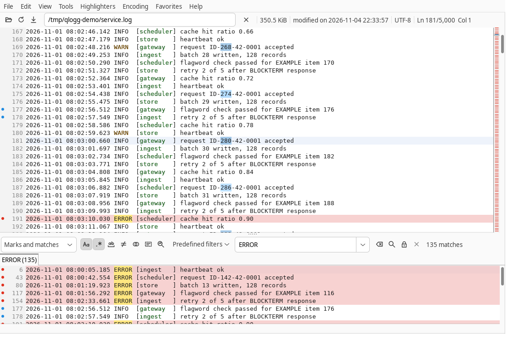

<picture>
  <source media="(prefers-color-scheme: dark)" srcset="qlogg-dist/src/icons/qlogg.svg">
  
</picture>

# QLogg

QLogg is a cross-platform viewer for large and growing log files, written in
Java 21 with SWT. It makes no outbound network connections; its only socket is
a loopback endpoint that passes files from a second launch to the running
instance.

QLogg is not an editor or a log collector, and it runs no macros, scripts or
plugins.

<picture>
  <source media="(prefers-color-scheme: dark)" srcset="docs/images/qlogg-dark.png">
  
</picture>

## Features

### Files and following

- Opens files from the command line, File > Open, File > Open Recent (with
  Clean Up), the Favorites menu or a drop on the window, one tab each. The
  first lines show while indexing continues in the background.
- Opens the clipboard's text (File menu, `Ctrl+V` in a log view), held in
  memory up to 16 MiB and never written to disk.
- Handles files of any size and line count: content stays on disk, and the
  scroll bar maps any line count onto its range.
- Reload (`F5`) keeps marks, mark comments and color labels; `Esc` stops
  loading.
- Follows the end of a file (`F`, `F10`, `-f`, or every file through View >
  Follow New Files). Scrolling up releases follow and scrolling down past the
  last line engages it. Growth is indexed as it arrives. A truncated, replaced
  or rotated file, or a symbolic link retargeted to another file, reopens by
  name with its results cleared, and a search with Auto-refresh on runs again;
  a deleted file keeps its content until it reappears. A reopen that fails runs
  again at each check of the file.
- Keep file closed (Tools > Options, Advanced, off by default) opens a log only
  for each read, so a writer on Windows can rename over a followed file. Old
  content is then unreadable after a rotation or delete.
- Detects the encoding (BOM, UTF-16, UTF-8, ISO-8859-1 fallback); the Encoding
  menu forces a charset and indexes the file again.

### Viewing

- Main window: a top row with the icon toolbar (Open, Reload, Follow), the
  file's path, Stop and the file's size (its tooltip gives the modification
  time), encoding, position and caret time; a tab row while two or more files are open; the
  search row, result tabs and filtered view below a splitter with a grip; a
  status bar for notes and notices.
- Tabs are movable and renamable, switch with `Ctrl+PageDown` and
  `Ctrl+PageUp`, and close by middle click or from the tab menu (this,
  others, left, right, all) or File > Close All. View > Opened Files and Switch to File
  (`Ctrl+Shift+O`) list the open files.
- A tab not shown gets a colored dot when its file grows: one color for new
  lines, another when its search gained matches; showing the tab clears it.
- Several main windows (File > New Window). A tab moves to another window
  with its document as it is (drag it onto that window, or out of every
  window for a new one, or View > Move to New Window).
- Line numbers, selection with mouse and keys, block selection (`Alt`-drag,
  `Alt+Shift` with the arrows, Edit > Block Selection) that copies the
  selected columns, go to line and `+line:N`.
- Copy, capped by a share of the heap; copy with line numbers; save the
  selection or the filtered view to a file. `Esc` stops a running copy or
  save.
- Tabs expand to 8 columns and a CR before LF is hidden. Text wrap (`W`, View >
  Wrap New Files), whitespace and line-end markers, and hidden ANSI colors in
  display, copy and search.
- Folding of multi-line entries such as stack traces (`Alt+Backspace`;
  collapse all `Ctrl+E Ctrl+C`, expand all `Ctrl+E Ctrl+X`), with rules in
  Tools > Options, Folding. Go to line, find next, mark jumps and quick find
  expand the entry they land in.
- Font zoom: `Ctrl`+wheel, View > Zoom In (`Ctrl+=`, `Ctrl`+keypad `+`), Zoom
  Out (`Ctrl+-`, `Ctrl`+keypad `-`) and Reset Zoom (`Ctrl+0`); the zoomed size
  is saved. `Alt`+wheel scrolls sideways and `Shift`+wheel by pages.
- Light, dark and system themes (View menu).

### Timestamps

- The timestamp format is detected when a file opens (ISO 8601, slashed and
  dotted dates, syslog, Common Log Format, Java logging, epoch seconds or
  milliseconds); View > Timestamps > Format picks another or None, and Edit
  Formats defines formats by regex and pattern. The choice and a Time Zone
  for local times are remembered per file.
- The top row shows the caret line's time; a selection over several lines
  shows the time from its first to its last line in the position field.
- Time Offset shifts every time a tab shows, as an offset or as the time the
  caret line should show; the session keeps it.
- Go to Time (`Ctrl+Shift+L`, or a click on the time field) goes to the
  first line at a time, else the last line before it; a file whose
  timestamps are out of order is searched line by line. `Esc` cancels it
  with any running mark, copy or save; loading stops at a second `Esc`.
- Scroll All Tabs to This Time goes to the caret line's time in every other
  tab of every window. Time Sync groups (tab and log-view context menus) keep
  their tabs on one time as the caret moves in any of them; each tab's offset
  applies, and the session keeps the groups.
- Time Spread shades the overview bar where lines come faster than average
  (Activity) or where they span more time than average (Pauses).

### Search and filtering

- Regex or literal search with match case, whole word, inverse, combined
  expressions (`"a" and not "b"`), in selection, and search start and end
  lines; option keys `4` to `9`. Next and previous match: `N`, `Shift+N`,
  `F3`.
- The filtered view under the main view shows matches, marks or both (`1`,
  `2`, `3`, `V`) with source line numbers; a click goes to the line. Kept
  result sets show as tabs (`9`).
- Context lines: the filtered view lists a chosen number of lines above and
  below each result, shaded, with a rule between groups.
- Range filter: every line from a line matching the search through the next
  line matching an end expression; `Ctrl+R` selects the range around the
  current line.
- Search all open files (`Ctrl+Shift+S`): one result group per file, each in
  its tab's filtered view.
- Quick find (`Ctrl+F`, `'`, `"`, `*`, `/`), search history with completion,
  predefined filters with import and export, and add, exclude or replace
  search with the selection (`Shift+A`, `Shift+E`, `Shift+R`).
- An overview bar beside the main view shows matches and marks; a click goes
  there.

### Highlighting and marks

- Highlighter sets: several active at once, regex or text, whole line or
  matched text, capture groups, opacity, color variance, import and export.
  Highlighters > Automatic Highlighters picks a set by file name or first
  line.
- Color labels (`Ctrl+D`, `Ctrl+Shift+1` to `9`, `Ctrl+Shift+0` or
  `Ctrl+Shift+D`) and the search match highlight.
- Marks (`M`, `]`, `[`, or a click in the bullet column), with match and mark
  bullets in the gutter.
- Mark comments (`Shift+M`, Edit > Edit Mark Comment): a commented mark has a
  square bullet whose tooltip shows the comment. Tools > Marks List lists the
  shown tab's marks with comments and line text; go to, edit and remove from
  the list.
- Keyword triggers on highlighter rules act on lines appended to an open
  file: stop follow, set a mark with a comment template, or keep the line off
  the tab dot.

### Sessions and settings

- Sessions restore the open tabs, the shown tab, tab names, follow, marks
  and mark comments at start (`-s`, `-n`, Tools > Options). A run given files or `-m` leaves the
  saved session alone; the session keeps each window's tabs.
- Remembered per file: position (`+line:N` wins), a forced encoding, and the
  timestamp format and zone chosen. A tab's time offset and time sync group
  are kept in the session.
  Remembered UI state: window size, position and maximized state, split,
  search toggles and history, line numbers, last Open directory and dialog
  sizes.
- Tools > Options: General, View (font, size, bold, anti-aliasing), File
  (default encoding, change monitoring), Shortcuts (rebind any command,
  duplicates refused, restore defaults), Advanced, and Folding (fold rules,
  checked before they apply).
- Scratchpad (Tools): text tabs with Base64, hex, URL, JSON and XML transforms
  and the selection's CRC32, number base and epoch time.

### Platform integration

- Single instance: a launch without `-m` hands its files to the running QLogg
  over an authenticated loopback connection and exits. Simultaneous launches
  end as tabs of one window, including while the first one is still starting.
  Handed files open in the window used last; a file a window already shows
  activates its tab; any failure opens a window of its own.
- Ending the process (SIGTERM, logoff) runs the quit, bounded at 3 s, so
  settings and the session are saved.
- Copy Full Path, Copy File Name, Open Containing Folder (Edit menu, tab menu
  and path field menu) and Open in Editor (Edit menu).
- Menus File, Edit, View, Tools, Highlighters, Encoding, Favorites and Help,
  with no mnemonic used twice in File, View or Tools; on macOS, About,
  Preferences and Quit sit in the application menu. Hand-drawn icons in light
  and dark ink.
- Help: Keyboard Shortcuts, Command-Line Options, Show Log (a status-bar
  marker flags new warnings), Debug Log File, Open Log Folder, Open Settings
  Folder, Report an Issue (copies the runtime details, then opens the issue
  page) and About.
- Help > Documentation shows the user guide (`docs/user-guide.md`), built into
  the jar as one page, in a browser window that loads nothing else. When that
  window has no browser or the page does not load within 15 s, the system
  browser opens a copy.

Every key binding is listed under Help > Keyboard Shortcuts.

## Building

Build with JDK 21 and the Maven wrapper:

```sh
xvfb-run -a ./mvnw clean verify
```

`verify` runs Spotless, Checkstyle, SpotBugs with find-sec-bugs, the ArchUnit
rules and every test, and builds the universal jar and the bundle for the
build host. Tests tagged `swt` open windows. On Linux they run when `DISPLAY`
is set and are skipped otherwise; Windows and macOS always run them, and macOS
runs them with `-XstartOnFirstThread`. Surefire sets `GDK_BACKEND=x11`, so
under `xvfb-run` the windows go to Xvfb even in a Wayland session. Fix
formatting with `./mvnw spotless:apply`.

| Command | Builds |
|---|---|
| `./mvnw clean verify` | Universal zip and the host target's bundle |
| `./mvnw clean verify -Dqlogg.target=<target>` | Universal zip and that target's bundle; compiles the UI against that target's SWT fragment and skips the `swt` tests |
| `./mvnw clean verify -Pall-targets` | Universal zip and all six bundles |

Archives are written to `dist/`, which no build step deletes. They are built on
Linux x86_64 only: packaging runs `tar`, `jlink`, `jmod`, launch4j's x86-64
Linux linker and `rcodesign`. On any other host `qlogg-dist` builds and
smoke-tests `qlogg.jar` and writes no archive. The Temurin JDK archives and
`rcodesign` are downloaded once into `~/.m2/repository/.cache/qlogg/`
(`-Dqlogg.cache.dir` overrides it) and checked against pinned SHA-256 digests.

Builds are reproducible: with the same JDK, two builds of one commit write
byte-identical jars, `qlogg.exe` and archives, every entry dated
`project.build.outputTimestamp` from the parent POM.
`.github/scripts/check-reproducible.sh` builds twice and compares SHA-256.

### Container build

A host with Docker (or Podman with compose) and no JDK builds in the image
`docker/Dockerfile` defines: Temurin 21, git, Xvfb and GTK 3. `compose.yaml`
holds the mounts and environment and runs the same `./mvnw`.

```sh
scripts/container.sh               # clean package -Pall-targets: seven archives into dist/
scripts/container.sh check         # xvfb-run ./mvnw clean verify, SWT tests included
scripts/container.sh clean         # ./mvnw clean, and empty dist/
scripts/container.sh shell         # a shell in the build image
scripts/container.sh --rebuild     # rebuild the build image first
scripts/container.sh --out DIR     # write the archives to DIR
scripts/container.sh ./mvnw -B spotless:check
```

Any other command runs verbatim in the image at the repository root. Windows
uses `scripts\container.bat` with the same arguments; WSL uses the Linux script.
The output directory is bind-mounted over `dist/`, so `clean` empties it and
never removes it. The Maven repository, the wrapper's Maven and the JDK cache
live in the named volume `qlogg-maven-repo`. On Linux the container runs as
the calling user, so files in `dist/` and `target/` belong to that user. The
service is `linux/amd64`, because packaging runs launch4j's x86-64 linker; an
arm64 host runs it under its engine's emulation.

### Continuous integration

`.github/workflows/ci.yml` runs on every push to `main`, every pull request
and every pushed `v*` tag:

| Job | Runners | Does |
|---|---|---|
| `test` | `ubuntu-24.04`, `ubuntu-24.04-arm`, `windows-2025`, `windows-11-arm`, `macos-15-intel`, `macos-15` | `./mvnw -B verify` on each target natively, SWT tests included (Linux under `xvfb-run`) |
| `package` | `ubuntu-24.04` | `./mvnw -B package -Pall-targets,sbom`; uploads the seven archives and the SBOM as `qlogg-archives`, kept 90 days for a tag and 14 otherwise |
| `bundle` | the six `test` runners | Unpacks the target's bundle, checks the runtime's `os.arch`, and starts the bundle's launcher until the main window opens |
| `test-gtk4` | `ubuntu-24.04` | The SWT modules' tests with `SWT_GTK4=1`; a test that hits a known GTK 4 failure skips itself |
| `release` | `ubuntu-24.04` | `v*` tags only, after every `test` and `bundle` job passes: runs `check-reproducible.sh`, writes `SHA256SUMS` over the `package` job's archives, checks the rebuild against it, and creates a draft GitHub Release |

The draft Release carries the seven archives the `bundle` jobs ran,
`SHA256SUMS` and `qlogg-<version>-sbom.cdx.json`, with GitHub's generated
release notes. To release:

1. Push the tag: `git tag v<version> && git push origin v<version>`.
2. Review the draft on the repository's Releases page.
3. Publish it there, or with `gh release edit v<version> --draft=false`.

A bad draft is fixed by deleting the draft and the tag
(`gh release delete v<version> --cleanup-tag`) and tagging again. Only the
`release` job has `contents: write`.

`-Psbom` writes the CycloneDX SBOM to `dist/`: every compile and runtime
dependency of the shipped modules, plus the six SWT fragments `qlogg.jar`
carries. It leaves out build-only tools, `qlogg-bench`, the Temurin runtimes
and launch4j's header. CI keeps the JDK archives and `rcodesign` in
`~/.cache/qlogg`, cached by the `package` and `release` jobs and keyed on
`qlogg-dist/src/build/dist.xml`; the Maven cache holds no JDK.

On Windows the `bundle` job starts `qlogg.exe`, finds the `javaw.exe` child
running `qlogg.jar`, and passes only when the child's image is the bundle's
`runtime\bin\javaw.exe` with the target's PE machine type (`ARM64` on
`windows-11-arm`). Actions are pinned by commit SHA. Linux jobs install Xvfb
and GTK 3 from the Ubuntu archive when the runner image lacks them.
`.github/workflows/dependency-check.yml` scans the dependencies for known
vulnerabilities weekly and on demand, failing on CVSS 7 or higher; it reads
the NVD API key from the `NVD_API_KEY` repository secret and reviewed false
positives from `config/dependency-check-suppressions.xml`. Dependabot proposes
Maven and Actions updates.

## Targets

| Target | SWT fragment | Bundle |
|---|---|---|
| linux-x86_64 | `gtk.linux.x86_64` | `qlogg-<version>-linux-x86_64.tar.gz` |
| linux-aarch64 | `gtk.linux.aarch64` | `qlogg-<version>-linux-aarch64.tar.gz` |
| windows-x86_64 | `win32.win32.x86_64` | `qlogg-<version>-windows-x86_64.zip` |
| windows-aarch64 | `win32.win32.aarch64` | `qlogg-<version>-windows-aarch64.zip` |
| macos-x86_64 | `cocoa.macosx.x86_64` | `qlogg-<version>-macos-x86_64.zip` (`QLogg.app`) |
| macos-aarch64 | `cocoa.macosx.aarch64` | `qlogg-<version>-macos-aarch64.zip` (`QLogg.app`) |

`qlogg-<version>.zip` holds the universal `lib/qlogg.jar`, which runs on all six
targets under an installed Java 21, with `bin/qlogg` and `qlogg.exe`. Each
bundle adds a Java runtime for its target, so it needs no installed Java. Linux
targets need the system GTK 3 libraries. GTK 4 is an experimental opt-in on
linux-x86_64: start QLogg with `SWT_GTK4=1` (GTK 4 libraries required); open
SWT GTK 4 defects affect scrolling and painting in the log view. The macOS
bundles are ad-hoc signed and not notarized, so macOS asks the user to approve
the first launch.

## Command line

```text
qlogg [options] [[+line:N] file]...
java -jar qlogg.jar [options] [[+line:N] file]...
```

| Option | Effect |
|---|---|
| `-h`, `--help`, `--help-all` | Print usage and exit 0 |
| `-v`, `--version` | Print `qlogg <version>` and exit 0 |
| `-d`, `--debug <level>` | stderr log level: `1` INFO, `2` DEBUG, `3` and above TRACE, or `error`, `warn`, `info`, `debug`, `trace`; WARN when absent. Show Log (INFO) and the `-l` file (DEBUG) take it when finer. It applies to QLogg's own loggers; the Java runtime's stay at INFO |
| `-l`, `--log` | Also write the log at DEBUG to `logs/qlogg.log` in the settings directory, for this run; a process that is not the running instance (`-m`, or a failed handoff) writes `logs/qlogg-<pid>.log` |
| `-m`, `--multi` | Run as an independent instance: no handoff, and it never replaces the saved session |
| `-s`, `--load-session` / `-n`, `--new-session` | Restore the last session's tabs / start without them. Without either, the session is restored when no file is given and `session.loadLast` is on |
| `-f`, `--follow` | Follow the files given |
| `--window-width <px>`, `--window-height <px>` | Client-area size, each independently; default 1024 x 768 |
| `--window-x <px>`, `--window-y <px>` | Window position; ignored on Wayland, where the compositor places windows |
| `--settings <dir>` | Settings directory, created owner-only when missing; holds `qlogg.conf` and QLogg's SWT native cache |
| `+line:N` | Open the next file at line N, once indexing reaches it; a line past the end goes to the last line |
| `--` | End of options |
| `file` | Files to open, a tab each; the last one is shown. Without `-m`, they go to the running instance for the same settings directory, with `-f` and `+line:N` |

Options combine: `-mf`, `--opt=value`, `-d2`. An unknown option
or a bad value prints a message to stderr and exits 1; an SWT start failure,
such as missing GTK libraries, exits 3.

## Settings directory

QLogg keeps its settings in `qlogg.conf`, the session in
`qlogg_session.conf` and the position and encoding override of the last 500
files in `positions.conf` (Java properties, `version=1`), in the first
directory that applies. The same directory holds the single-instance files
`instance.lock` and `instance.endpoint`, the `logs` folder and the `cache`
folder with the user guide's copy:

| Mode | When | Directory |
|---|---|---|
| Explicit | `--settings <dir>` | `<dir>` |
| Portable | `qlogg.conf` exists in the installation directory, the parent of `lib/` | The installation directory |
| Per-user | Otherwise | Linux `$XDG_CONFIG_HOME/qlogg` (default `~/.config/qlogg`), Windows `%APPDATA%\QLogg`, macOS `~/Library/Application Support/QLogg` |

An empty `qlogg.conf` in the installation directory selects portable mode. In
explicit and portable mode on Linux, `user.home` is the settings directory, so
GTK's `.swt/trims.prefs` lands there too. On Windows the user guide's browser
keeps its data in `cache\webview2`.

On Linux and macOS a launch hands its files over only when the settings
directory belongs to the current user and no one else can write it; otherwise
every launch opens its own window.

| Key | Values | Default | Set from |
|---|---|---|---|
| `ui.theme` | `light`, `dark`, `system` | `light` | View > Light, Dark or System Theme |
| `search.historySize` | 1 to 1000 | 50 | Edit > Search > Edit Search History; Tools > Options |
| `search.history.N` | Search text, most recent first | none | Each search; Edit > Search > Clear Search History |
| `search.maxResults` | 0 (no limit) or the match count that stops a search; read at startup | 0 | Tools > Options, Advanced |
| `search.runOnAdd` | `true`, `false` | `true` | Edit > Search > Search After Add, Exclude or Replace |
| `filter.N.name`, `filter.N.pattern`, `filter.N.regex` | A predefined filter | none | Tools > Predefined Filters, Save as Filter |
| `quickFind.incremental`, `quickFind.regex` | `true`, `false` | `true`, `false` | The quick find bar |
| `view.splitPercent` | 10 to 90: the main view's share of the split | 70 | View > Save Splitter Position |
| `view.overview` | `true`, `false` | `true` | View > Overview Bar |
| `view.timeSpread` | `off`, `activity`, `pauses` | `off` | View > Timestamps > Time Spread |
| `follow.onLoad` | `true`, `false`: every file opens following | `false` | View > Follow New Files |
| `follow.onOverscroll` | `true`, `false`: scrolling down past the last line engages follow | `true` | View > Follow on Overscroll |
| `follow.keepClosed` | `true`, `false`: files opened or reloaded afterwards stay open only for each read | `false` | Tools > Options, Advanced |
| `highlight.set.N.*`, `highlight.active.N` | Highlighter sets and the active set ids | none | Highlighters menu and Configure Highlighters |
| `label.N.name`, `.fore`, `.back`, `.cycle` | Color label N, 0 to 8 | 9 labels, all in the cycle | Configure Highlighters, Color Labels tab |
| `matchHighlight.enabled`, `.color`, `.variance` | Match highlight; an empty color is the theme's | `true`, theme, 0 | View > Highlight Search Matches; Configure Highlighters |
| `view.wrapOnOpen` | `true`, `false`: files open with text wrap on | `false` | View > Wrap New Files |
| `view.showWhitespace` | `true`, `false` | `false` | View > Show Whitespace |
| `view.hideAnsi` | `true`, `false`: ANSI color sequences are removed for display, copy and search | `false` | View > Hide ANSI Colors |
| `fold.entryStart`, `fold.continuation.N` | Regexes: an entry's first line, or continuation lines when `fold.entryStart` is empty | empty; `^\s`, `^at `, `^Caused by:`, `^\.\.\. \d+ more` | Tools > Options, Folding |
| `highlight.selector.N.glob`, `.firstLine`, `.set` | A rule picking a highlighter set for a file as it opens | none | Highlighters > Automatic Highlighters |
| `font.family`, `font.size` | The log views' font; empty and 0 are the platform's monospace font and size | empty, 0 | Tools > Options, View |
| `font.zoom` | 4 to 72: the size zooming chose; 0 is not zoomed | 0 | `Ctrl`+wheel, View > Zoom In, Zoom Out, Reset Zoom |
| `font.bold`, `font.antialias` | `true`, `false` | `false` | Tools > Options, View |
| `recent.count` | 1 to 50: files File > Open Recent keeps | 20 | Tools > Options, General |
| `recent.N` | Recent file paths, most recent first | none | Each opened file; File > Open Recent > Clean Up |
| `favorite.N` | Favorite file paths, at most 100 | none | Favorites menu |
| `monitor.pollMillis`, `monitor.watchService` | 100 to 60000 ms between checks of a file; also check on directory change events | 1000, `true` | Tools > Options, File |
| `encoding.default` | The charset detection falls back to | `ISO-8859-1` | Tools > Options, File |
| `session.loadLast` | `true`, `false`: a start without files restores the session | `true` | Tools > Options, General |
| `shortcut.<COMMAND>.count`, `.N` | Key bindings that replace a command's defaults: `window` or `view`, then the keys | none | Tools > Options, Shortcuts |
| `window.x`, `.y`, `.width`, `.height`, `.maximized`, `.split` | The normal position and client size, maximized state and split of the window used last at the last exit; `--window-*` options win for that run | none | Exit |
| `log.file` | `true`, `false`: the log also goes to `logs/qlogg.log` (`logs/qlogg-<pid>.log` in a process that is not the running instance; the running instance deletes those older than 7 days when it starts with the log on) | `false` | Help > Debug Log File |
| `searchOption.*` | The search toggles, range end and context counts a new tab starts with | regex, match case | The search toggles |
| `view.lineNumbers`, `view.filteredLineNumbers` | Line numbers in a new tab's views | `true` | View > Line Numbers |
| `open.directory` | Where File > Open starts with no file shown | none | File > Open |
| `dialog.<name>.width`, `.height` | A dialog's last size | none | Closing the dialog |
| `time.zone` | Zone id of local times in files without a zone chosen | system zone | `qlogg.conf` |
| `time.displayZone` | Zone id times show in | system zone | `qlogg.conf` |
| `time.format.N.name`, `.locate`, `.pattern` | A user timestamp format: a name, a regex whose group `ts` holds the time, a `DateTimeFormatter` pattern; at most 32 | none | View > Timestamps > Edit Formats |

A value out of range falls back to its default.

## Layout

| Path | Contents |
|---|---|
| `qlogg-bootstrap/` | Entry point of `qlogg.jar`: Java version check, target selection, SWT natives, nested-jar class loader |
| `qlogg-core/` | Threads, memory budget, file access, encoding, line index, documents and viewport; no SWT, no logging dependency |
| `qlogg-app/` | Command line, key bindings, controllers, view contracts, settings, search history and filters, About facts; no SWT |
| `qlogg-ui-swt/` | SWT views: main window, log views, search and quick find bars, dialogs; the toolbar icon set (`src/icons/*.svg`), rendered to PNG at build time |
| `qlogg-launcher/` | Composition, logging configuration, architecture rules |
| `qlogg-dist/` | Universal jar, launchers, runtimes and archives; icons |
| `qlogg-bench/` | Benchmark harness, JMH probes and comparison scripts; not shipped |
| `config/` | Checkstyle, SpotBugs and find-sec-bugs configuration |
| `docker/`, `compose.yaml`, `scripts/` | Container build |
| `.github/` | CI workflow and the scripts its steps run |
| `tools/icons.sh` | Renders the application icon from `qlogg-dist/src/icons/*.svg` |
| `docs/user-guide.md`, `docs/images/guide/` | The user guide Help > Documentation shows, and its screenshots |
| `tools/screenshots.sh`, `docs/images/` | Writes the light and dark screenshots and the user guide's images under Xvfb from generated mock logs (Linux) |

## Documents

Each module's `README.md` describes its design and contracts;
`qlogg-core/TESTING.md` describes the core test strategy. `docs/user-guide.md`
is the user guide. `NOTICE` and
`qlogg-dist/src/dist/THIRD-PARTY.txt` list the licenses of shipped components.
