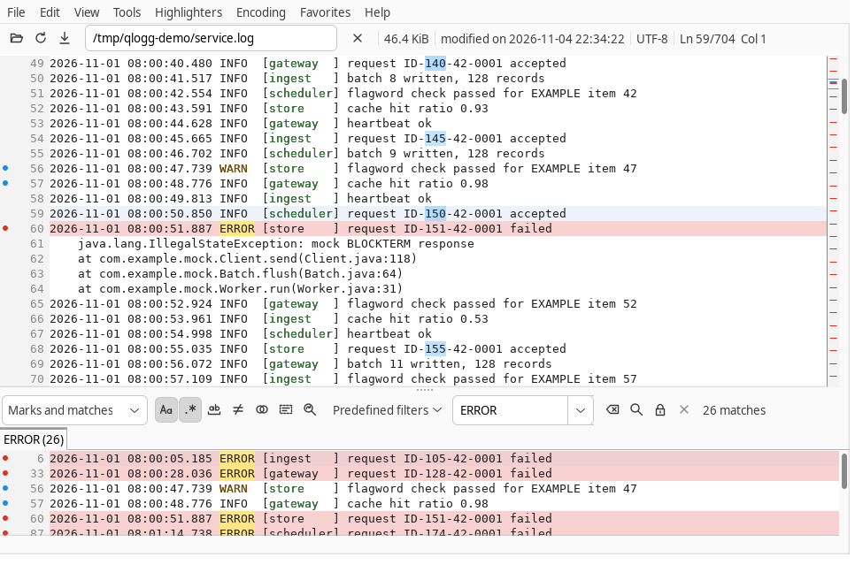
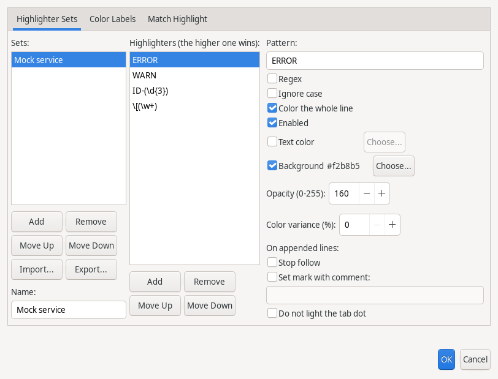
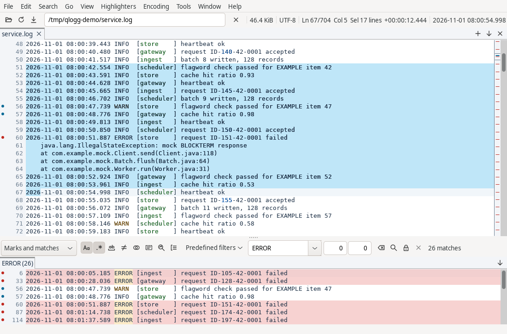
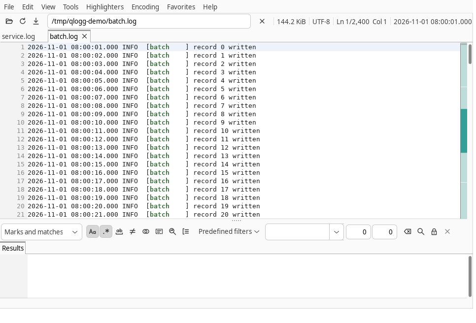
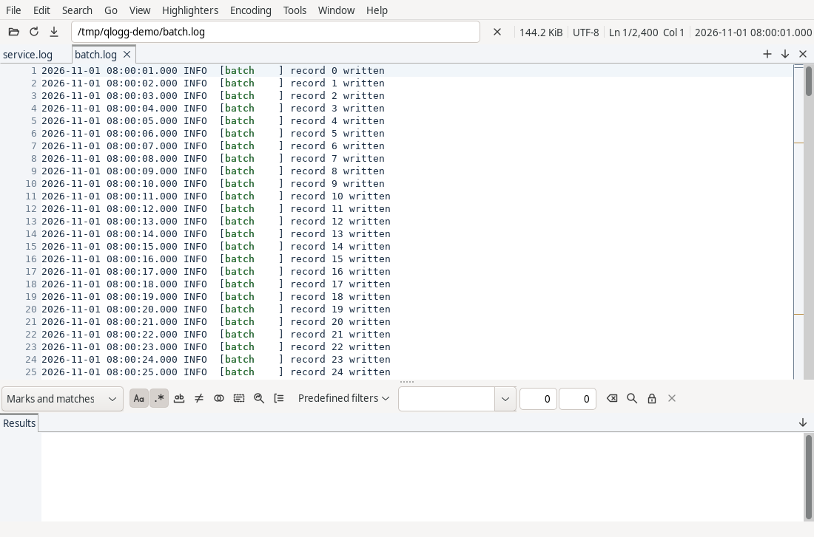
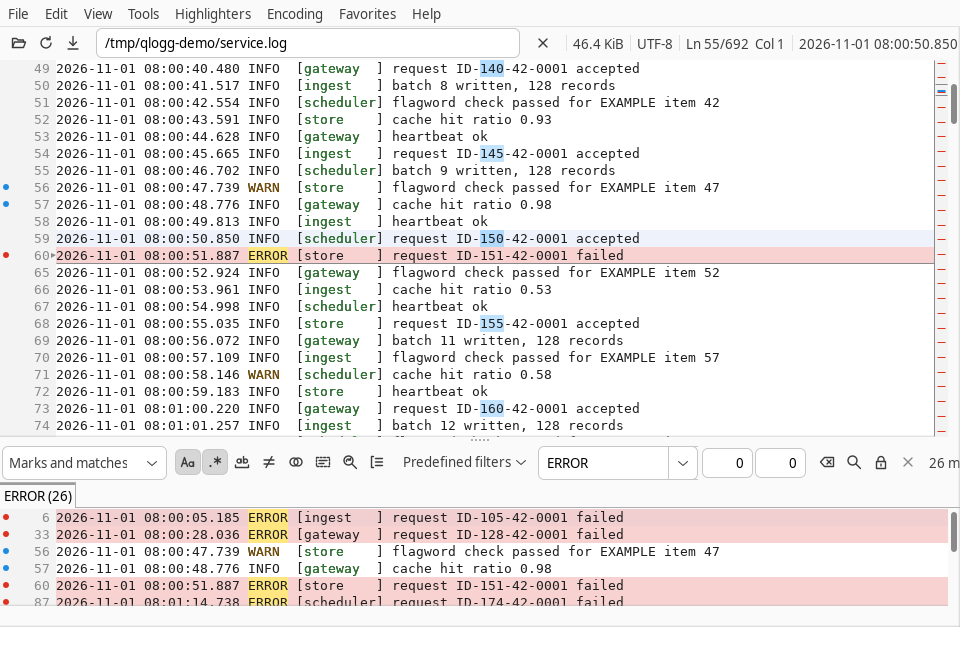
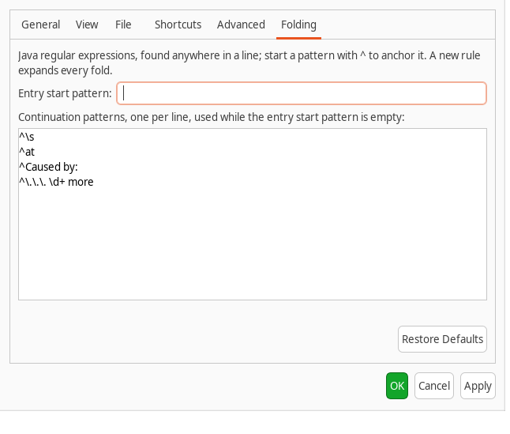
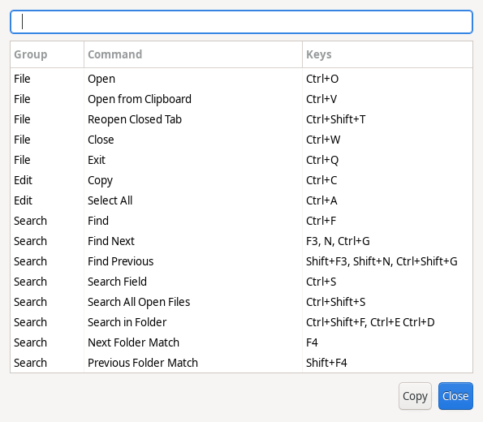

# QLogg User Guide

QLogg shows large and growing log files without loading them into memory. It
never connects to another computer; a second launch hands its files to the
running QLogg over a local-only connection. On macOS, `Ctrl` in this guide is
`Cmd`; Help > Keyboard Shortcuts lists every key for your platform and Tools >
Options, Shortcuts changes them.

- [Opening files](#opening-files)
- [The main window](#the-main-window)
- [Moving around](#moving-around)
- [Search and the filtered view](#search-and-the-filtered-view)
- [Marks and quick find](#marks-and-quick-find)
- [Highlighters and color labels](#highlighters-and-color-labels)
- [Following a growing file](#following-a-growing-file)
- [Timestamps](#timestamps)
- [Folding multi-line entries](#folding-multi-line-entries)
- [Selecting, copying and saving](#selecting-copying-and-saving)
- [View options](#view-options)
- [Scratchpad](#scratchpad)
- [Sessions, recent files and favorites](#sessions-recent-files-and-favorites)
- [Windows and the running instance](#windows-and-the-running-instance)
- [Options](#options)
- [Help menu and logs](#help-menu-and-logs)
- [Command line](#command-line)

## Opening files

Open files with File > Open (`Ctrl+O`), by dropping them on the window, from
File > Open Recent or File > Favorites, or on the command line. Each file
opens in its own tab; a dropped folder is not opened. The first lines show at
once while indexing continues in the background; `Esc` or the Stop button
stops it. File > Open from Clipboard (`Ctrl+V` in a log view) opens the
clipboard's text, up to 16 MiB, held in memory only.

Reload (`F5`) reopens the shown file and keeps its marks, mark comments and
color labels.
QLogg detects the encoding from the byte order mark and the content; the
Encoding menu forces another one, and the choice is remembered for the file.

## The main window



- The top row holds Open, Reload and Follow, the file's path (its menu copies
  the path or opens the containing folder), Stop, and the file's size,
  encoding, position and the time of the current line
  ([Timestamps](#timestamps)). The size's tooltip shows when the file last
  changed.
- A tab row appears while a file is open. A tab's menu closes tabs, copies the
  path, opens the folder, renames the tab or moves it to a new window; a middle
  click closes it. File > Close Multiple Tabs closes the tabs around the shown
  one. Closing the last tab leaves an empty window, unless Close the window
  with its last tab is on in Tools > Options, General; in the last window that
  quits QLogg. Window > Opened Files and Switch to File
  (`Ctrl+Shift+O`) list the tabs.
- The buttons at the right end of the tab row open files (+), list every tab
  (the arrow, with the number of tabs the row cannot show) and close the
  current tab (x). The list marks the current tab and shows each tab's dot;
  choosing a tab shows it. The mouse wheel over the tab row scrolls hidden
  tabs into view without changing the current tab. The result tabs have the
  same list button.
- A tab that is not shown gets a dot when its file grows: green for new lines,
  orange when the tab's search, with Auto-refresh on, found new matches,
  purple when a highlighter trigger stopped follow. A reload or truncation
  counts as new lines. Showing the tab clears the dot.
- The overview bar beside the main view marks matches and marks across the
  whole file; a click goes there.
- Below the splitter: the search row, the result tabs and the filtered view.
  `+` and `-` resize the main view; View > Filtered View > Save Splitter
  Position keeps the split.
- The status bar shows indexing, follow and notices. A warning marker appears
  when QLogg logs a warning; a click opens Help > Show Log.

## Moving around

| Keys | Action |
|---|---|
| Arrows, `j`, `k`, `h`, `l` | Move the current line, scroll sideways |
| `Page Up`, `Page Down` | Move one page |
| `Ctrl+Up`, `Ctrl+Down` | Scroll without moving the current line |
| `Ctrl+Home`, `Ctrl+End`, `G` | First line, last line |
| `Home`, `0`, `^`, `$`, `End` | Line start, line end, right edge of the text |
| `Ctrl+L` | Go to a line |
| `Ctrl+Shift+L` | Go to a time |
| `Alt+Left`, `Alt+Right` (macOS: `Control+Command+Left`, `Control+Command+Right`) | Go back to the line before a jump, and forward again |
| `Ctrl+PageDown`, `Ctrl+PageUp` | Next and previous tab |
| `Space` | Switch between the main and the filtered view |
| `Ctrl`+wheel, `Ctrl+=`, `Ctrl+-`, `Ctrl+0` | Zoom in, out, back to the Options size |
| `Alt`+wheel, `Shift`+wheel | Scroll sideways, scroll by pages |
| `Ctrl+Shift+P` | Command palette |

Go > Go Back and Go Forward walk each tab's last 100 jumps: Go to Line, a
`+line:N`, Go to Time, Go to Top and Bottom, Find Next and Previous, the next or
previous mark, a Marks List row, a quick find match, and a click or `Enter` on
a filtered-view row. Scrolling and moving the current line are not jumps. A
reload keeps the jumps; a shorter file moves those past its end to its last
line. Go Back and Go Forward are gray when there is no jump in that direction.

View > Command Palette lists every menu command with its menu and keys. Type
letters of the command's name in order, such as `gtl` for Go to Line, and press
`Enter` to run the first one. Commands that cannot run now are gray.

## Search and the filtered view

Type a pattern in the search row and press `Enter`. Matching lines appear in
the filtered view below the main view; a click there goes to the line in the
main view. `n` and `N` (`F3`, `Shift+F3`) go to the next and previous match.

The icon toggles beside the field, also on keys `4` to `9` in a log view:

| Toggle | Effect |
|---|---|
| Match case | Case-sensitive search |
| Regular expression | Java regular expression, else plain text |
| Whole word | The match must be a whole word |
| Inverse | Lines that do not match |
| Combine | Expressions such as `"error" and not "retry"` |
| In selection | Only the selected lines |
| Auto-refresh | Search lines appended to a followed file |
| Keep results | The next search adds a result tab instead of replacing the results |
| Range | Every line from a line matching the pattern through the next line matching the range end; no key |

### Limits, views and filters

- Search > Search Limits > Set Search Start and Set Search End limit every
  search to the lines between; Clear Search Limits removes the limit.
- The filtered view lists matches, marks or both (`1`, `2`, `3`; `v` and `V`
  cycle).
- The history drop-down recalls earlier patterns. Tools > Predefined Filters
  stores named patterns, with import and export.
- `Shift+A`, `Shift+E` and `Shift+R` add the selected text to the search,
  exclude it, or replace the search with it.

### Context lines

The two number fields after the pattern set the context lines: the filtered
view lists that many lines above and below each result, on a shaded
background, with a rule above each group.

- Counts, `n` and `N`, the overview bar and the bullets in the margin use the
  results only.
- A kept result tab keeps the counts its search ran with; a changed count
  applies to the next search.
- The context lines after the last result fill in as the file grows, with or
  without Auto-refresh.

### Range search

With Range on, a field for the end pattern appears beside the pattern. The
results are every line from a line matching the pattern through the next line
matching the end, both lines included.

- A range still open at the end of the file runs to the end and, with
  Auto-refresh, extends as the file grows.
- Inverse lists the lines outside the ranges.
- The search start, end and In selection limits apply as for any search.
- Search > Select Range Around Line (`Ctrl+R` in a log view) selects
  the range around the current line of the main view: the nearest line above
  that matches the pattern, through the next line matching the end.

### Searching all open files

Search > Search All Open Files (`Ctrl+Shift+S`) runs the search in every tab;
each tab's filtered view gets the results for its file. It ignores In
selection; each tab's search start and end lines apply.

### Searching a folder

Search > Search in Folder searches the files of a folder without opening a tab
for each. It starts with the folder, file names and Include subfolders of
the last folder search, kept between runs of QLogg, and the shown tab's search
text and toggles.
File names takes globs separated by `;`; the default `*.log*` matches a log
and its rotated copies. Include subfolders searches the folders below it;
links to folders are not followed.

The upper table lists each file with its matches; selecting a file lists its
matching lines below. Double-click a line, or press Enter, to open the file at
that line, or to go there in the tab that already shows it. Compressed or
binary files show Not text, and files that cannot be read show why. When
the matching lines fill the memory set aside for results, the search stops
and says so; narrow the search or the file names.

## Marks and quick find

`m` marks or unmarks the selected lines; a click in the bullet column marks
one line. `]` and `[` go to the next and previous mark. Marks show in the
gutter, the overview bar and the filtered view.

### Mark comments

`M` (Go > Edit Mark Comment) asks for a comment on the current line and
marks the line when it has no mark; an empty comment keeps the mark without
one. A commented mark has a square bullet, and the pointer over it shows the
comment. Unmarking a line drops its comment. A comment is one line of at most
200 characters; a file keeps at most 1,000.

### Marks list

Go > Marks List lists the shown tab's marks with line number, comment and
the start of the line, and follows the tab you show. `Enter` or a double
click goes to the line, `Delete` removes the selected marks and `F2` edits a
comment in the list. It lists the first 10,000 marks.

### Quick find

Quick find (`Ctrl+F`, `'` forward, `"` backward) searches the shown view from
the current line without changing the filtered view. `*` and `/` find the
selected text forward and backward.

## Highlighters and color labels



A highlighter set is a list of rules: a pattern, plain text or regular
expression, that colors the whole line or only the matched text, with
optional capture groups, opacity and color variance. Several sets can be
active at once from the Highlighters menu. Highlighters > Automatic
Highlighters picks a set when a file opens, by file name or first line. Sets
import and export from the Configure Highlighters dialog.

Color labels color every occurrence of the selected text: `Ctrl+D` takes the
next color, `Ctrl+Shift+1` to `Ctrl+Shift+9` a given one, `Ctrl+Shift+0` or
`Ctrl+Shift+D` clears them; Highlighters > Color Label and the log view
context menu list the labels by name. Highlighters > Highlight Search Matches
colors the last search's matches.

### Keyword triggers

A rule can also act on lines appended to an open file (Configure
Highlighters, "On appended lines"). Every matching rule of an active set
acts, whatever its color precedence. Lines already in the file when it opens
or reloads never trigger.

| Action | Effect |
|---|---|
| Stop follow | Follow turns off. The status bar names the rule; a tab that is not shown gets the purple dot. |
| Set mark with comment | The line is marked. A comment on the line stays; otherwise the comment is the template with its placeholders expanded. |
| Do not light the tab dot | The line does not count as new, and a search match on it does not count as a new match. |

A comment template expands these placeholders:

| Placeholder | Expands to |
|---|---|
| `%L` | Line number |
| `%F` | Full path |
| `%P` | Directory |
| `%N` | File name |
| `%M` | File name without its extension |
| `%E` | Extension |
| `{regex}{replacement}` | The line with every match of `regex` replaced; `$1` is the first group, so `{.*user=(\w+).*}{$1}` gives the user name |

A template whose regular expression fails is kept as typed.

## Following a growing file

Follow (`f`, `F10`, the Follow button, or `-f` on the command line) keeps the
end of the file in view as lines arrive. Scrolling up stops following;
scrolling down past the last line starts it again (View > Follow on
Overscroll). View > Follow New Files follows every file as it opens.

### Rotation and deletion

A file that is truncated, replaced or rotated reopens by name with its results
cleared; a search with Auto-refresh on runs again. A deleted file keeps its
content on screen until a file with that name appears again.

When the file cannot be opened at that moment, for example between a log
rotator's rename and its create, the tab keeps its content, shows one notice
and reads Waiting to reopen in the status bar in place of Following. QLogg
tries again at each check of the file, once a second by default, and following
resumes when the file opens.

### Keep file closed

QLogg holds a file open while its tab is open, and Windows refuses a rename
over an open file, so a program that rotates its log that way fails. Tools >
Options, Advanced, Keep file closed opens the file only for each read. It
applies to files opened or reloaded afterwards.

With it on, the content of a moved or deleted file cannot be read: a deleted
file shows a notice and only lines already read stay on screen. A rename that
lands during a read is still refused, and a retry succeeds.

## Timestamps



QLogg finds the timestamp at the start of each line when a file opens: ISO
8601 (`2026-03-01 05:00:00.002`, with `T`, a comma or a zone offset), dates
with slashes or dots, `01 Mar 2026`, syslog (`Mar  1 05:00:00`), Common Log
Format, Java logging (`Mar 01, 2026 5:00:00 AM`) and epoch seconds or
milliseconds. A line without a timestamp, such as a stack trace line, takes
the time of the line above it.

### Time field

The top row shows the current line's time. Its tooltip names the format, the
time zone and the offset; a click opens Go to Time. A file without timestamps
leaves it empty and disables the timestamp commands.

### Selection difference

With several lines selected, the position field adds the time from the first
to the last selected line, for example `Sel 4 lines  +00:01:23.456`, or
`+2d 03:00:00.000` past a day. A negative time means the lines are out of
order. In the filtered view the lines are the selected rows' lines.

### Timestamp format

View > Timestamps > Format picks another format, or None. QLogg remembers the
format you pick for each file.

Edit Formats defines your own: a name, a regular expression whose group named
`ts` finds the time in the first 256 characters, and a pattern such as
`yyyy-MM-dd HH:mm:ss.SSS`. The editor shows the value it reads from the
current line before you save.

### Time zone

Times without a zone are read in the zone set in View > Timestamps > Time Zone
for the file, else `time.zone` in `qlogg.conf`, else the system zone. Times
show in `time.displayZone`, else the system zone, so files written in
different zones compare on one clock.

### Time offset

View > Timestamps > Time Offset shifts every time the tab shows, as
`[+-][d.]HH:mm:ss[.fff]` or as the time the current line should show; zero
clears it. The line text does not change. The session keeps the offset, and a
reload keeps it.

### Go to Time

Go to Time (`Ctrl+Shift+L`, Go menu) takes `yyyy-MM-dd HH:mm:ss`, or
`HH:mm:ss` on the current line's date, with an optional fraction. QLogg goes to
the first line with that time, else the last line before it, and stops
following. A time before the first line goes to the first line.

A file whose timestamps go backward, such as two logs joined together, is
searched line by line with progress in the status bar. QLogg finds such a file
by sampling it, so a short out-of-order stretch can go unnoticed; Go to Time
can then land beside that stretch instead of on the time.

While a go to time runs, `Esc` stops it and any running mark, copy or save;
loading goes on until a second `Esc`.

### Scroll All Tabs to This Time

Scroll All Tabs to This Time (Go menu, log view context menu) moves every
other tab with a timestamp format, in every window, to the current line's time
and stops its following. Each tab applies its own time offset.

### Time Sync

Time Sync (tab and log view context menus) keeps tabs on one time. Check
another tab to join it: that tab moves to this tab's time, or, when it is in a
group already (its number shows beside it), this tab joins and moves to its
time.

- Moving the current line in a member moves the others shortly after; a
  hidden tab moves too.
- A move reaching a member stops its following, but following in a member
  moves nobody.
- The tab's tooltip shows its group.
- Uncheck a tab or choose Leave Time Sync to leave. A group left with one tab
  ends.
- Groups survive a reload and a move to another window, and the session keeps
  them.

### Time spread

View > Timestamps > Time Spread shades the [overview bar](#the-main-window) by
how the lines spread over time, for every open file with a format. Off is the
default.

| Mode | Shades rows |
|---|---|
| Activity | Where lines come at least twice as fast as the average |
| Pauses | That span at least twice the average time |

The color deepens at 4, 8 and 16 times. Purple rows are places where the time
goes backward. A click still goes to the line under the pointer. A growing file
updates every 2 seconds.





## Folding multi-line entries



A fold hides an entry's continuation lines, such as a stack trace, under its
first line. `Alt+Backspace` collapses or expands the entry at the current line;
`Ctrl+E Ctrl+C` collapses every entry as it scrolls into view and
`Ctrl+E Ctrl+X` expands them all. Going to a line, a match or a mark inside a
collapsed entry expands it. Copy, mark and save skip hidden lines. The overview
bar shrinks a collapsed entry to one line and shows its hidden matches and
marks there; a click on it leaves the entry collapsed.

By default a line continues the entry above it when it starts with white
space, `at `, `Caused by:` or `... N more`. Tools > Options, Folding changes
the rules for every file:



- **Entry start pattern**: when set, every line it does not match continues
  the entry above. A pattern such as `^\d{4}-\d{2}-\d{2}` suits logs whose
  entries start with a date.
- **Continuation patterns**: one per line, used while the entry start pattern
  is empty; a line matching any of them continues the entry above.

Patterns are Java regular expressions found anywhere in the line, so anchor
them with `^`. A pattern that does not compile is refused with the reason.

## Selecting, copying and saving

Drag or use `Shift` with the arrows to select lines; `Ctrl+A` selects all.
`Alt`-drag, `Alt+Shift` with the arrows, or Edit > Block Selection selects a
rectangle of columns. Edit > Set Selection Start and End select the lines
between two chosen lines.

`Ctrl+C` copies the selection, or the current line without one. Edit > Copy
with Line Numbers puts each line's number in front. File > Save Selection and
Save Filtered Results write the lines to a file in UTF-8. `Esc` stops a copy or
save that is still running; a stopped save writes no file. One copy or save
runs at a time. Both take the first MiB of a longer line, and the saved notice
counts the lines cut. A copy or save fails when the file became shorter while
it was read.

## View options

The View menu holds line numbers in either view, text wrap (`w`, and Wrap New
Files), markers for tabs, trailing spaces and line ends, hiding ANSI color
sequences (for display, copy and search), the overview bar, and the light,
dark and system themes. Light and dark also apply to menus, scroll bars and
other controls: at once on Linux, at the next start on Windows, which says so
when you change it. On Windows the system theme applies them too, from the
Windows setting at start; the title bar, menu bar, buttons, scroll bars, lists
and dialogs turn dark and the main window's toolbars stay light. On Linux the
GTK theme must have a dark variant. On macOS controls follow the system
appearance and the theme recolors the log views.

### View colors

Tools > Options, View, View colors picks the colors of the log views, gutter,
overview bar and tab strips apart from the theme, as a terminal profile does.
Follow theme, the default, uses the theme's light or dark colors. Light and
Dark use those colors whatever the theme, so the log views can be dark in
light chrome and the reverse. A named scheme keeps its colors through every
theme change, including a system appearance change; menus, dialogs and other
controls keep following the theme. A change applies at once.

| Scheme | Colors |
|---|---|
| Light | Navy on white |
| Dark | Light gray-blue on navy |
| Sandstone | Gray-blue on cream |
| Nightwater | Gray-blue on dark teal |
| Garden Light | Charcoal on light gray |
| Garden Dark | Light gray on charcoal |
| Legal Pad | Black on light yellow |
| Paper | Black on white |
| Midnight | White on black |
| Phosphor | Green on black |
| Graphite | Gray on black |

Text in every listed scheme reaches a contrast of 4.5:1 on each row color,
the match highlight and the default color labels.

To add a scheme, put a file named `<id>.properties` in the `colors` folder of
the settings directory ([Command line](#command-line)); QLogg reads the folder
at start and lists the schemes after the bundled ones. `<id>` is letters,
digits, `-` and `_`, and is not `follow`, `light`, `dark` or a bundled
scheme's id. The file sets `dark=true` or `dark=false`, which picks
the color label variants, an optional `name=` shown in the list, and each of
these keys as `#rrggbb`:

| Keys | Colors |
|---|---|
| `text`, `background`, `currentLine`, `contextRow`, `resultRow` | Line text, the view, the caret's line, context lines, filtered rows |
| `selection`, `selectionText` | Selected text |
| `match`, `mark`, `labelGray` | Search match, marked line, the gray color label |
| `gutter`, `lineNumbers`, `matchMarker`, `markMarker` | Gutter, its numbers and bullets; also the tab strip background |
| `overview`, `overviewFrame`, `spreadPause`, `spreadActivity` | Overview bar and its time spread |
| `newLinesDot`, `newMatchesDot`, `followStoppedDot` | Tab dots; `followStoppedDot` also marks time running backward |

A file with a missing or invalid value is skipped, and the log records one
warning naming it.

## Scratchpad

Tools > Scratchpad holds text tabs. `Ctrl+Z` in a log view appends the
selection to it and `Ctrl+Shift+Z` replaces its text. It converts Base64, hex,
URL encoding, JSON and XML, and shows the selection's CRC32, number base and
epoch time.

## Sessions, recent files and favorites

QLogg restores the last session at start when no file is given (Tools >
Options, General; `-s` and `-n` decide for one run): the tabs of each window,
the shown tab, tab names, follow, marks, mark comments, time offsets, time
sync groups and each window's Always on Top. Each file's
position and forced encoding are remembered; `+line:N` wins over the position.

File > Open Recent lists recent files (Clean Up drops missing ones). File >
Recently Closed lists the last 20 files whose tabs you closed; a reopened file
returns to its position. Open All on either list opens every listed file and
names any it could not open; Clear empties Recently Closed. File > Reopen
Closed Tab (`Ctrl+Shift+T`) takes the newest file off
Recently Closed and opens it. File > Favorites adds, removes and opens
favorite files.

## Windows and the running instance

Window > New Window opens another main window.

View > Always on Top keeps a window above other windows; each window has its
own setting, and a new window starts without it. Dialogs the window opens stay
above it. It is unavailable on Linux under Wayland or GTK 4, where the window
manager's window menu (`Alt+Space`) offers Always on Top instead.

### Moving tabs between windows

A tab moves between windows with everything it shows: its position,
selection, marks, search results, filtered view, folds, follow state and name
stay, and the file is not read again.

- Drag a tab onto another QLogg window: over its tab row, the tab lands where
  it is dropped; anywhere else in that window, after the last tab.
- Drag a tab outside every QLogg window: a new window opens at the drop point,
  where the window system allows placing it.
- The tab menu and Window > Move to New Window move a tab to a new window. A
  window left without tabs stays open.

A tab does not move into a window that already shows the same file, or while
its file is reloading.

### Launching QLogg again

A launch without `-m` hands its files to the QLogg already running for the
same settings directory and exits. The files open in the window used last,
which comes to the front. A file a window shows already is shown in that tab
instead of a second one, with `+line:N` and `-f` applied. On macOS, files
opened from the Finder or dropped on the Dock icon arrive the same way.

## Options

Tools > Options (on macOS, QLogg > Preferences) has these tabs:

| Tab | Settings |
|---|---|
| General | Restore the last session, recent file count, search history size, search after add, quick find options, follow options, close the window with its last tab |
| View | Font family and size, bold, anti-aliasing, [view colors](#view-colors) |
| File | Default encoding, change notifications and the check interval |
| Shortcuts | Rebind any command; keys another command holds are refused; restore defaults |
| Advanced | Stop a search after a number of matches; Keep file closed ([Following a growing file](#following-a-growing-file)) |
| Folding | The fold rules ([Folding multi-line entries](#folding-multi-line-entries)) |



## Help menu and logs

| Item | Action |
|---|---|
| Documentation | This guide, in its own window; when the window cannot show it within 15 seconds, and on Linux in portable and `--settings` mode, in your system browser |
| Keyboard Shortcuts (`F1`) | Every binding, with a filter and Copy |
| Command-Line Options | The `--help` text |
| Show Log | QLogg's recent log lines |
| Debug Log File | Writes the log at DEBUG to `qlogg.log` in the settings directory's `logs` folder; a QLogg started with `-m`, or one that could not reach the running instance, writes `qlogg-<pid>.log` there, and the running instance deletes those older than 7 days when it starts with this on |
| Open Log Folder, Open Settings Folder | The folder in the file manager |
| Report an Issue | Copies the runtime details, then opens the project's issue page in the browser |
| About QLogg | Version, license and runtime details; on macOS in the QLogg menu |

## Command line

```text
qlogg [options] [[+line:N] file]...
```

| Option | Effect |
|---|---|
| `-h`, `--help` | Print usage and exit |
| `-v`, `--version` | Print the version and exit |
| `-d`, `--debug <level>` | Log level on stderr: `1` INFO, `2` DEBUG, `3` TRACE, or a level name |
| `-l`, `--log` | Also write the debug log file for this run |
| `-m`, `--multi` | Run as an independent instance: no handoff, and the saved session stays as it is |
| `-s`, `--load-session` | Restore the last session |
| `-n`, `--new-session` | Start without the last session |
| `-f`, `--follow` | Follow the files given |
| `--window-width <px>`, `--window-height <px>` | Window size; default 1024 x 768 |
| `--window-x <px>`, `--window-y <px>` | Window position |
| `--settings <dir>` | Settings directory |
| `+line:N` | Open the next file at line N |

QLogg keeps its settings in `qlogg.conf` in the settings directory: Linux
`~/.config/qlogg`, Windows `%APPDATA%\QLogg`, macOS
`~/Library/Application Support/QLogg`, or the installation directory when a
`qlogg.conf` exists there (portable mode). On Linux in portable mode and with
`--settings`, Help > Documentation opens this guide in your system browser,
because the embedded browser keeps its cache in your home folder. GTK's input
method support still creates an empty `~/.config/ibus/bus` folder there, and
with the experimental GTK 4 backend (`SWT_GTK4=1`) the graphics driver writes
its shader cache to `~/.cache/mesa_shader_cache` on every run.
